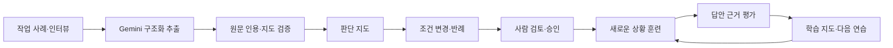

# 판단 공방 · Judgment Atelier

**전문가가 무엇을 보고, 왜 그렇게 선택했는지 배우는 작은 실험 공방.**

한 번의 작업 경험을 상황·단서·선택·근거·예외가 연결된 판단 지도로 펼칩니다. 조건 하나를 바꿔 규칙의 경계를 시험하고, 처음 보는 상황에서 자신의 선택과 이유를 설명하며 판단을 연습합니다.

> “여백을 줄이는 게 좋다”는 조언을 배웠다면, 정보 전달이 최우선인 안내문에서도 같은 선택을 해야 할까요?

이 프로젝트는 이런 갈림길을 탐색하는 **Gemini API 기반 전문성 전이 프로토타입**입니다. 한국어 UI, 로컬 데이터 저장, 키 없이 체험할 수 있는 디자인 예시 세 개를 제공합니다.

## 무엇을 할 수 있나요?

| 기능 | 해보는 일 |
| --- | --- |
| 사례 인터뷰 | 실제 작업 사례에서 판단 단서를 추출하고 추가 질문에 답하기 |
| 판단 지도 | 상황·단서·선택·근거·예외를 연결하고 각 노드의 원문 확인하기 |
| 기초 지식 지도 | 해당 판단에 필요한 선행 개념 살펴보기 |
| 조건 바꾸기 | 목적·매체·관람 거리 등을 바꾸어 기존 규칙의 반례 만들기 |
| 사람의 검토·승인 | 원문과 AI 해석을 대조하고 적용 경계를 확인한 규칙을 훈련에 사용하기 |
| 판단 연습 | 새로운 상황에서 대안을 선택하고 관찰 단서와 선택 이유 설명하기 |
| 학습 지도 | 다섯 판단 능력, 힌트 사용, 확신도와 수행 기록 돌아보기 |
| 기록 내보내기 | 원문·검토·답안·평가·이벤트를 JSON으로 내려받기 |

## 1분 만에 데모 실행

**Python 3.11 이상과 `make`**가 필요합니다. 앱 실행에는 외부 Python 패키지나 Node.js가 필요하지 않습니다.

```sh
git clone https://github.com/overdozya/work.git judgment-atelier
cd judgment-atelier
make demo
```

브라우저에서 **[http://127.0.0.1:8791](http://127.0.0.1:8791)**을 엽니다. `make`가 없으면 `python3 -m atelier.server`로 실행할 수 있습니다. 키와 모드 설정이 없는 첫 실행은 데모로 시작합니다.

데모는 다음 세 사례로 전체 흐름을 체험합니다.

- **여백이 많으면, 늘 좋은 걸까?** — 표현의 긴장감과 정보 전달의 가독성.
- **강한 색이 주인공을 가릴 때** — 더 강조하기와 경쟁 요소 덜어내기.
- **제목을 키우기 전에 볼 것** — 절대적인 크기와 주변 요소의 위계.

**데모의 반례·훈련은 고정 예시입니다.** 입력 조건을 의미적으로 분석하거나 학습자의 답안을 채점하지 않습니다. 데모 기록으로 숙련도 점수를 만들거나 학습 단계를 올리지 않습니다.

포트가 사용 중이면 다음처럼 변경할 수 있습니다.

```sh
ATELIER_PORT=8792 make demo
```

## Gemini 연결

[Google AI Studio](https://aistudio.google.com/apikey)에서 API 키를 발급받고 설정 파일을 만듭니다.

```sh
cp .env.example .env
```

`.env`를 편집합니다.

```dotenv
GEMINI_API_KEY=발급받은_API_키
GEMINI_MODEL=gemini-3.8-flash
ATELIER_MODE=gemini
ATELIER_PORT=8791
```

실행 중인 데모 서버를 종료한 뒤 다시 실행합니다.

```sh
make run
# make가 없는 환경: python3 -m atelier.server
```

프로세스 환경변수가 `.env`보다 우선합니다. 키 없이 Gemini 모드를 명시하면 생성 작업에서 설정 오류를 반환합니다. **실제 API 실패를 데모 결과로 바꾸지 않습니다.** 모델은 `GEMINI_MODEL`로 변경할 수 있으며 계정의 사용 가능 여부는 실호출로 확인해야 합니다.

API 키는 서버에서만 읽고 Google 요청 헤더에 담습니다. 브라우저로 보내지 않습니다. Gemini 모드에서 제출한 사례·인터뷰·학습 답안은 Google API로 전송됩니다. `.env`와 로컬 데이터는 Git에서 제외됩니다.

기본 모델과 구조화 출력 형식은 2026-10-11에 확인한 [모델 문서](https://ai.google.dev/gemini-api/docs/models/gemini-3.8-flash)와 [구조화 출력 문서](https://ai.google.dev/gemini-api/docs/generate-content/structured-output)를 따릅니다. **현재 실호출과 생성 품질은 API 키 미설정으로 미검증**이며, API 계약과 오류 처리는 가짜 전송 계층으로 검증했습니다.

## 공방을 사용하는 순서

1. **사례 선택 또는 입력** — 홈의 예시를 열거나 자신의 작업 경험을 적습니다.
2. **지도 탐색** — 노드를 눌러 원문을 확인합니다. ‘원문 · 인터뷰’의 추가 질문에 답하면 Gemini가 지도를 다시 작성합니다.
3. **조건 변경** — 목적·거리·매체 중 하나를 바꾸어 반례와 적용 경계를 살펴봅니다.
4. **검토와 승인** — 실제 경험에 근거한 메모와 검토자 이름을 남깁니다. 수정이 필요하면 인터뷰로 돌아가고, 적용 경계를 확인했다면 훈련용으로 승인합니다.
5. **새 상황 연습** — 선택과 이유를 설명하고 필요하면 힌트를 엽니다. 확신도도 함께 기록합니다.
6. **학습 지도 확인** — 수행 근거를 돌아보고 실험 기록을 내보냅니다.

인터뷰나 반례를 수정하면 승인이 해제됩니다. 현재 승인과 다른 훈련을 이어서 제출할 수 없습니다. 원문 지도 버전이 바뀌면 새 버전에서 학습 근거를 모으고 과거 기록은 보존합니다.

## 아키텍처



| 계층 | 구성과 역할 |
| --- | --- |
| 화면 | HTML·CSS·JavaScript, SVG 판단 지도, 데스크톱·모바일 UI |
| 애플리케이션 | Python 표준 라이브러리 HTTP 서버, 명시적인 인터뷰·검토·훈련 흐름 |
| 모델 | 서버 전용 Gemini REST 어댑터, JSON schema 결과 검증 |
| 저장 | SQLite, 문서 버전 비교, 승인·훈련 스냅샷·최소 감사 이벤트 |

서버가 승인 상태, 힌트 사용, 학습 단계를 결정합니다. Gemini는 판단 구조·반례·시나리오·피드백을 제안합니다. 원문에 없는 인용, 연결되지 않은 지도, 근거 없는 양의 점수, 범위를 벗어난 응답은 저장하지 않습니다. 로컬 LLM과 벡터 DB는 사용하지 않습니다.

자세한 계약, 상태 전이와 확장 방향은 [아키텍처 문서](docs/ARCHITECTURE.md)에 정리했습니다.

## 어떻게 학습 단계를 조정하나요?

**단서 관찰 · 맥락 확인 · 대안 비교 · 근거 설명 · 새 상황 전이**의 다섯 차원을 살펴봅니다. 답안의 정확한 문장을 근거로 0~4점의 잠정적인 AI 피드백을 만듭니다. 선택이 전문가와 달라도 근거가 타당하면 인정하도록 요청합니다.

초기 힌트 3개 → 다음 단계 2개 → 독립·전이 단계 0개로 도움이 줄어듭니다. 서로 다른 문제에서 다섯 차원 모두 3점 이상을 힌트 없이 수행한 **연속 기록 두 개**가 모이면 한 단계 올라갑니다. 최근 수행에서 약한 차원을 다음 문제의 초점으로 전달합니다.

이 점수는 검증된 숙련도 척도가 아닙니다. 질문 횟수나 답변 길이로 이해도를 추정하지 않으며, 실제 교육 효과는 별도의 전문가 평가와 비교 실험으로 확인해야 합니다. [실험 계획](docs/EXPERIMENT.md)을 참고하세요.

## 프로젝트 구성

```text
atelier/
  schemas.py       구조화 계약·인용·지도 연결 검증
  gemini.py        서버 전용 Gemini REST 어댑터
  fixtures.py      직접 작성한 디자인 데모
  store.py         SQLite 저장과 버전 충돌 방지
  service.py       인터뷰·반례·승인·적응형 훈련
  server.py        로컬 HTTP API·요청 경계
web/               한국어 반응형 UI와 판단 지도
tests/             워크플로·HTTP·Gemini 계약·브라우저 검증
docs/              아키텍처·실험 계획·PR 설명·자체 검토
.local/            SQLite·검증 결과 — Git 제외
.env               Gemini 키와 로컬 설정 — Git 제외
```

이 저장소는 독립 프로젝트입니다. Skalapse의 API·데이터·프런트엔드와 연결하지 않습니다.

## 검사하기

Python 3.11 이상, Node.js 18 이상, `make`가 있는 환경에서 실행합니다.

```sh
make check
```

Python 테스트 **31개**와 JavaScript 문법을 검사합니다. 승인 경계, 정확한 원문·답안 인용, 버전 충돌, 힌트 제한, 단계 상승, 데이터 재열기, 로컬 HTTP 보안, Gemini 요청과 오류 처리를 포함합니다. 실제 API 호출이 없어 키나 API 비용이 필요하지 않습니다.

선택적인 브라우저 검사는 Playwright와 Chrome이 설치된 환경에서 실행합니다.

```sh
npm install --no-save --package-lock=false playwright
make browser-check
```

지도 → 반례 → 사람 검토·승인 → 훈련 → 내보내기, 390px 모바일 다섯 화면과 모달, 콘솔 오류를 확인합니다. 사용자 DB와 분리된 테스트 DB를 `.local/` 아래에 만들며 스크린샷과 내보내기 결과도 그 안에 저장합니다.

## 데이터 보존과 현재 범위

원문·인터뷰·검토·답안·힌트 기록은 `.local/atelier.sqlite3`에 저장합니다. 코드 업데이트로 초기화하지 않습니다. 다른 컴퓨터로 옮기거나 코드를 되돌릴 때는 서버를 종료한 뒤 `.local/`과 `.env`를 별도로 백업하세요. JSON 내보내기는 분석용이며 가져오기 기능은 없습니다.

현재는 **단일 사용자 로컬 프로토타입**입니다. 서버는 `127.0.0.1`에만 바인딩하며 Host·Origin·보안 토큰·입력 크기·정적 파일 경로를 확인합니다. 계정·조직 권한·외부 공개 서비스 배포는 구현하지 않았습니다.

후속 실험은 다음과 같습니다.

- 실제 작업물 이미지·영상과 관찰 기록으로 인터뷰의 회상을 대조하기.
- 여러 전문가의 다른 판단을 적용 조건과 함께 비교하기.
- 승인된 규칙 직접 편집과 의미가 비슷한 훈련 문제 중복 검출하기.
- 일반 문서·RAG 챗봇·판단 훈련의 교육 효과를 별도 과제로 비교하기.

## 개발·검토 기록

변경은 `feat/`, `fix/`, `chore/` 브랜치에서 작업하고 `make check` 후 PR로 검토합니다. 검증을 통과한 변경만 `main`에 반영하며 `.env`·`.local/`·런타임 데이터를 보존합니다.

[변경 설명과 파일별 체크리스트](docs/PR.ko.md) · [작성자의 자체 검토](docs/SELF_REVIEW.ko.md) · [교육 효과 실험 계획](docs/EXPERIMENT.md)
