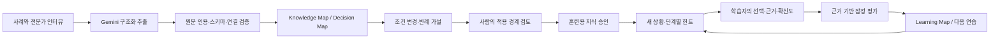
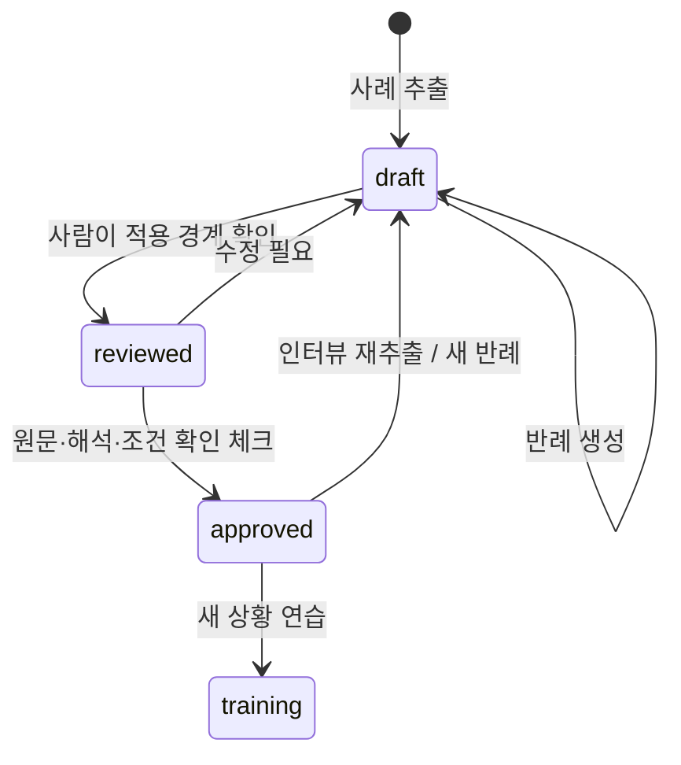

# 전문가의 판단을 연습 가능한 구조로 바꾸기

목표는 전문가와 같은 결론을 말하는 AI가 아니라, 학습자가 **단서를 발견하고 선택을 정당화하며 적용 경계를 판단하는 것**입니다. 인터뷰는 전문가의 실제 사고 과정 전체를 복원한다는 보장이 없습니다. 추출 결과는 사람이 검토할 가설로 저장합니다.

## 왜 이 세 가지 기능인가

- **판단 지도**: 원문에서 ‘그래서 무엇을 했다’만 뽑지 않고 상황·단서·선택·근거·예외를 연결합니다. 노드마다 출처를 확인할 수 있어 결론과 근거를 함께 탐색합니다.
- **조건 바꾸기**: ‘여백을 줄인다’라는 규칙을 ‘표현 목적에서 정보 전달 목적으로 바뀌면?’이라는 반례로 시험합니다. 맞는 말을 그럴듯하게 재생산하는 기능보다 규칙의 경계를 찾는 경험을 중심에 둡니다.
- **도움이 사라지는 판단 연습**: 사례를 그대로 복사한 퀴즈 대신 다른 목적·매체·관람 조건을 제시합니다. 답안의 다섯 능력과 힌트 사용 기록으로 다음 훈련을 구성합니다.

## 전체 흐름

브라우저는 서버 API에만 요청합니다. Python 서비스가 상태를 결정하고 Gemini는 추출·반례·시나리오·피드백의 구조화된 결과만 제안합니다. SQLite는 원문과 각 버전, 검토 기록, 답안, 생성된 시나리오 스냅샷, 최소 감사 이벤트를 저장합니다. 로컬 LLM이나 벡터 DB는 사용하지 않습니다.

## 데이터 경계

| 데이터 | 의미 | 검증 |
|---|---|---|
| `original_source` | 최초 제공된 사례 | 재추출에도 보존 |
| `source`, `interviews` | 추가 전문가 답변을 포함한 자료 | 길이 제한·원문 보존 |
| `knowledge` | 선행 개념의 목록 | 식별자·필드 계약 |
| `nodes.evidence` | 관찰 기록 / 전문가 회상 / AI 일반화 | 직접 인용은 원문 부분 문자열, AI 일반화는 인용 비움 |
| `edges` | 판단 요소 간 관계 | 존재하는 노드·연결성 검증 |
| `rule`, `rubric` | 조건부 규칙과 평가 기준 | 다섯 차원 완비·범위 제한 |
| `counterfactual.review` | 사람의 검토 결과·조건·검토자 | 검토 메모와 명시적 확인 |
| `approval` | 현재 지도에 대한 훈련 허용 | 매 승인마다 고유 식별자 |
| `session.map_snapshot` | 당시 사용한 지도 | 추후 변경과 구분 |
| `session.case_approval` | 사용한 승인 식별자 | 갱신된 승인과 오래된 훈련 구분 |
| `session.hints_used` | 서버에서 연 힌트의 수 | 클라이언트가 임의 지정할 수 없음 |
| `assessment.dimensions` | 실제 답안 근거와 잠정 점수 | 인용은 답안 부분 문자열, 점수 0~4 정수 |

관찰 기록인지 회상인지는 모델의 분류 가설입니다. 존재하는 인용이라고 해서 사실성이 입증되는 것은 아닙니다. 사람이 원문·작업 기록과 대조해야 합니다. 데모 원문은 제품 체험용으로 작성한 사례이며 실제 인터뷰 연구 데이터가 아닙니다.

## 승인과 버전

지도 `revision`과 문서 `version`을 구분합니다. 인터뷰 재추출은 둘 다 증가합니다. 반례·검토·승인은 문서 버전만 증가합니다. 모든 변경은 SQLite에서 `expected version`과 비교해 저장하며 충돌하면 409를 반환합니다. 새로운 반례와 인터뷰 수정은 승인을 해제합니다. 승인마다 새 ID를 만들어 이미 열린 훈련이 재승인 후 다시 사용되는 것도 막습니다. 승인된 지도가 바뀌면 현재 버전의 수행 근거를 새로 수집합니다. 이전 기록은 삭제하지 않습니다.

모든 POST는 단일 작업 게이트를 통과합니다. 재생성이나 채점 요청이 겹쳐 비용이 중복되는 일을 줄입니다. 미완료 훈련이 있으면 시작 버튼을 다시 눌러도 같은 훈련을 반환합니다. 네트워크 단절에 대한 클라이언트 재요청의 완전한 멱등성은 아직 구현하지 않았습니다.

## 훈련과 적응

다섯 평가 차원은 단서 관찰, 맥락 확인, 대안 비교, 근거 설명, 새 상황 전이입니다. 차원별 0=근거 없음, 1=언급, 2=부분 적용, 3=맥락상 타당한 적용, 4=예외까지 독립 설명입니다. 선택이 전문가와 달라도 타당한 근거가 있으면 인정하도록 요청합니다. 점수에 근거가 있으면 학습자의 정확한 문장을 인용해야 합니다.

단계는 모델이 임의로 결정하지 않습니다. 서버가 서로 다른 시나리오의 연속 수행 두 개를 확인합니다. 둘 다 힌트 없이 모든 차원 3점 이상일 때 한 단계 올라갑니다. 동일 문제의 재제출과 이미 제출한 세션의 변경은 막습니다. SHA-256은 동일 문장의 재생성을 막지만 의미가 비슷한 문제까지 검출하지는 못합니다. 직전 문제들을 생성 프롬프트에 제공해 중복을 줄입니다.

최근 다섯 수행 평균에서 가장 낮은 차원을 다음 문제의 초점으로 전달합니다. 개념 이해 자체를 진단하는 별도 사전평가는 아직 없습니다. 단계가 올라간 뒤 성과가 떨어지면 초점을 조정하지만 단계 자동 하락은 구현하지 않았습니다.

정답 참고 메모·평가 기준·아직 열지 않은 힌트는 훈련 API 응답에 포함하지 않습니다. 내보내기 파일에는 분석을 위해 당시 기준과 스냅샷을 함께 넣습니다. 도제학습 모델링→코칭→도움 감소→전이 흐름을 참고하지만 교육 효과를 증명한 구현은 아닙니다.

## Gemini 어댑터

[Gemini generateContent](https://ai.google.dev/api/generate-content) REST 호출을 서버에서 직접 수행합니다. [공식 구조화 출력](https://ai.google.dev/gemini-api/docs/generate-content/structured-output)의 `generationConfig.responseFormat.text` JSON schema를 사용하고 애플리케이션에서 다시 검증합니다. 기본 모델은 [gemini-3.8-flash](https://ai.google.dev/gemini-api/docs/models/gemini-3.8-flash)이며 환경변수로 바꿀 수 있습니다. 확인일: 2026-10-11.

각 요청은 45초 제한, 응답은 1MB 제한입니다. 429·일시적인 5xx에는 1초 뒤 한 번 재시도합니다. 인증·권한·모델 오류는 재시도하지 않습니다. 잘린 응답·잘못된 JSON·인용 불일치는 결과를 저장하지 않습니다. 한 HTTP 요청에서 일시 오류가 있으면 최대 약 91초가 걸릴 수 있습니다. 실시간 스트리밍·작업 취소·사용량 집계는 후속 범위입니다.

## 로컬 보안과 배포 범위

- 127.0.0.1 바인딩, 허용 Host 및 Origin 검사, cross-site 요청 거부.
- POST에는 페이지가 받은 프로세스별 보안 토큰이 필요합니다. CORS는 열지 않습니다.
- 정적 파일은 고정 목록만 제공합니다. 경로를 파일시스템에 임의 연결하지 않습니다.
- UI는 모델·사용자 텍스트를 HTML escape해 표시합니다. CSP로 외부 스크립트와 inline 스크립트를 제한합니다.
- API 키는 환경변수·`.env` → 서버 메모리 → Google 요청 헤더로만 이동합니다.
- 자료·답안·원시 API 오류·키를 요청 로그에 기록하지 않습니다.
- 데이터와 `.env`는 독립 저장소에서 제외합니다. 부모 저장소에서 이 폴더를 통째로 추가하면 안 됩니다.

이는 단일 사용자 로컬 실험 범위입니다. 다른 로컬 프로세스의 접근이나 악성 브라우저 확장으로부터 격리하는 인증 제품은 아닙니다. 외부 배포 전에는 사용자 인증, 조직별 접근 제어, 감사 로그, 암호화, 데이터 정책, 모델 평가가 필요합니다.

## 다음 구조 확장

작업물·실제 관찰 기록을 `artifact/evidence`로 추가하고 원문 인용과 연결하면 인터뷰 회상의 한계를 보완할 수 있습니다. 복수 전문가의 규칙을 `expert_id`와 적용 조건별로 묶으면 충돌을 하나의 정답으로 눌러 담지 않아도 됩니다. 현재의 서비스 계층과 구조화 계약을 유지한 채 파일 처리·검색 계층을 별도 어댑터로 붙일 수 있습니다. 더 많은 에이전트나 큐는 동시 사용과 긴 미디어 작업의 필요가 확인된 후 추가합니다.
